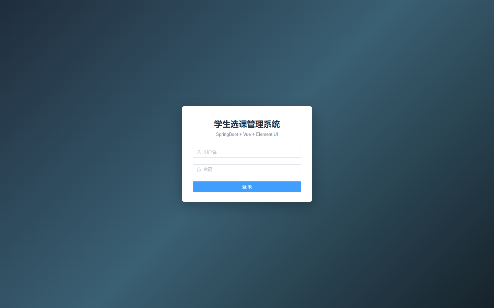
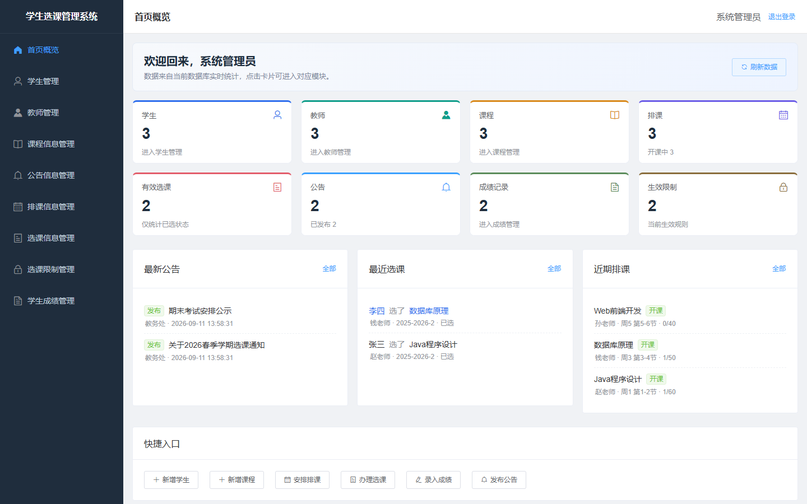
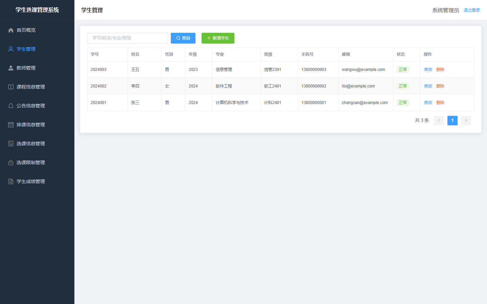
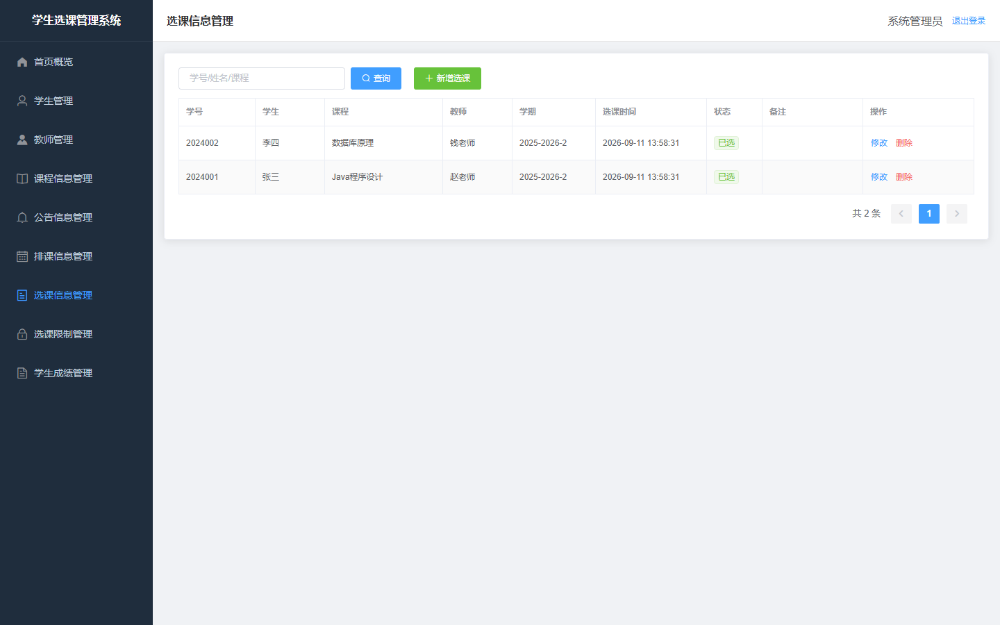

<p align="center"></p>

<h1 align="center">学生选课管理系统</h1>

<p align="center">Spring Boot + Vue 2 + Element UI + MySQL，前后端分离的教务演示系统</p>

<p align="center">
  <a href="LICENSE">MIT 许可</a> ·
  <a href="SECURITY.md">安全说明</a>
</p>

## 简介

一套能完整跑通的教务管理演示：从学生、教师、课程、公告这些基础数据，到排课、选课、选课限制、成绩管理，把一学期的流程走完。适合课程设计与毕业设计参考；安全能力面向教学场景，正式上线前请先读 [SECURITY.md](SECURITY.md)。

## 功能

- 学生、教师、课程、公告的增删改查
- 排课与选课：时间冲突校验、选课限制（名额 / 年级 / 专业）
- 成绩录入与查询
- 首页实时统计与快捷入口
- 管理员登录鉴权：BCrypt 密码 + Token

## 技术栈

| 端 | 技术 |
|---|---|
| 前端 | Vue 2.7 · Element UI · Vue Router · Axios |
| 后端 | Spring Boot 2.7 · MyBatis-Plus |
| 数据库 | MySQL 5.7+ / 8.x |

## 快速开始

**1. 初始化数据库**（UTF-8 导入，避免中文乱码）

```bash
mysql -uroot -p --default-character-set=utf8mb4 < sql/course_selection.sql
```

**2. 配置并启动后端**

```bash
cd backend
cp src/main/resources/application-example.yml src/main/resources/application-local.yml
mvn spring-boot:run -Dspring-boot.run.profiles=local
```

默认端口 `8088`，上下文路径 `/api`。

**3. 启动前端**

```bash
cd frontend
npm install
npm run serve
```

访问 http://localhost:8080。导入官方 SQL 后可用初始化管理员登录：`admin` / `admin123`（登录页不展示该账号，上线前务必修改）。

## 界面

| 登录 | 首页概览 |
|---|---|
|  |  |

| 学生管理 | 选课管理 |
|---|---|
|  |  |

其余页面截图见 `screenshots/` 目录。

## 项目结构

```
backend/      Spring Boot 服务
frontend/     Vue 前端
sql/          数据库脚本
screenshots/  界面截图
docs/         部署、接口、系统设计与开发提示词
```

## 文档

- [部署说明](docs/部署说明.md)
- [接口说明](docs/接口说明.md)
- [系统设计文档](docs/系统设计文档.md)
- [安全说明](SECURITY.md)

## 许可证

[MIT](LICENSE)
